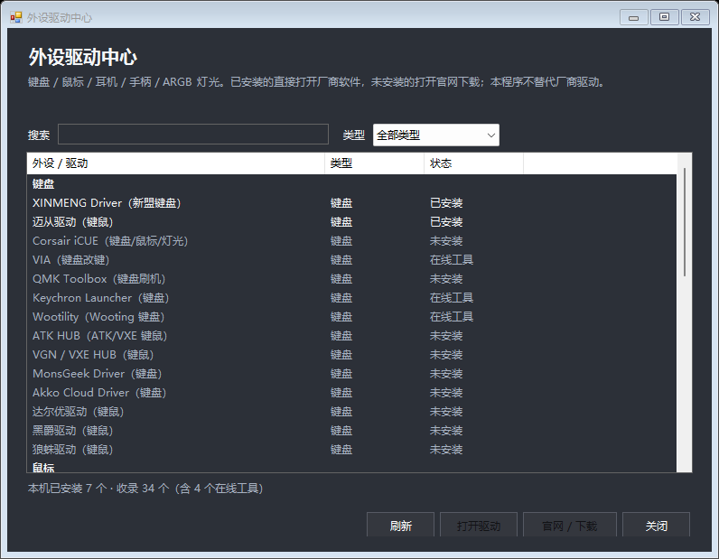

# 硬件驱动增强版说明

本分支基于 [wushuai0802/myfinder-device-battery](https://github.com/wushuai0802/myfinder-device-battery) 修改，保留原有电量卡片、设备读取和托盘界面，新增以下硬件控制与厂商软件入口。

## 1. 鼠标硬件控制（雷柏 VT7 V2）

右键鼠标电量卡片可直接操作，不经过雷柏 A HUB：

- **7 档 DPI 自定义编辑**：每一档 X/Y 可分开填 100–30000，可设置启用前 N 档、选择当前档位；写入后自动读回逐项比对。
- **当前档位切换**：直接写鼠标板载档位。
- **回报率**：8000 / 4000 / 2000 / 1000 / 500 / 250 / 125 Hz，直接写 HID。
- 协议：配置基址 `base+648`（X 轴 7 档）、`base+712`（Y 轴 7 档）、`base+662`（启用档数）、`base+664`（当前档位）、`base+640`（回报率）；写集合 `usage 0x0E`，读集合 `usage 0x0F`。
- 需要普通用户权限；仅在检测到雷柏接收器/有线连接时启用。

## 2. 鼠标宏 / 按键替换

- 软件内新建宏，3 秒倒计时后录制，`Ctrl+Alt+F10` 停止（最长 60 秒）。
- 捕获触发键：支持鼠标侧键 1/2、中键、左右键、键盘任意键。
- 触发时由低层键盘/鼠标钩子接管并播放宏；另有 15ms `GetAsyncKeyState` 轮询兜底。
- 宏保存于 `%LOCALAPPDATA%\MyFinderDeviceBattery\mouse-macros.json`。
- 属于**软件层按键替换**，不写鼠标固件；本程序运行期间生效。不建议把左键/右键设为触发键。

## 3. 耳机控制

- **7.1 虚拟环绕**：Windows Sonic，按耳机端点开关，普通权限。
- **变声器**：低沉 / 原声 / 尖锐 / 卡通，本地 48kHz 实时处理。
- **降噪**：麦克风噪声门。
- 变声/降噪需要 Voicemeeter / VB-CABLE 等虚拟声卡端点，并把 Voicemeeter Virtual Input 的 B1 点亮；7.1 不依赖虚拟声卡。

## 4. 开机自启

- 托盘右键“开机自启”或“设置… → 开机自动启动（登录后静默运行）”。
- 创建/删除 `%APPDATA%\Microsoft\Windows\Start Menu\Programs\Startup\MyFinder 设备电量.lnk`。
- 只写当前用户目录，不需要管理员；会清除 Windows“启动应用”里的禁用标记。

## 5. 外设驱动中心

托盘右键 **外设驱动中心…**，或在设备卡片右键 **外设驱动中心（键盘 / 灯光 / 手柄 / 鼠标）…** 打开。



功能：

- 自动扫描当前用户桌面、公共桌面和开始菜单中的快捷方式，识别本机已安装的厂商软件；
- 按键盘 / 鼠标 / 耳机 / 手柄 / 灯光 / 主板整机分类；
- 支持搜索和类型筛选；
- 已安装的“打开驱动”，未安装的“官网 / 下载”；
- 键盘卡片、手柄卡片右键还会直接列出本机已安装的对应厂商驱动。

### 本机已识别（示例机器）

| 驱动 | 类型 | 实际路径 |
| --- | --- | --- |
| XINMENG Driver（新盟键盘） | 键盘 | `C:\Users\21657\Desktop\XINMENG Driver.lnk` |
| OpenRGB（ARGB 灯光） | 灯光 | `C:\Users\21657\Desktop\OpenRGB - 快捷方式.lnk` |
| 北通智控（手柄） | 手柄 | `C:\Users\Public\Desktop\北通智控.lnk` |
| 雷柏 A HUB | 鼠标 | `D:\sbqd\2\RAPOO AHUB 2.0\RAPOO AHUB 2.0.exe` |
| XIBERIA Audio Center | 耳机 | `D:\XIBERIA Audio Center X\CPL\XIBERIA Audio Center X.exe` |
| MCHOSE HUB | 键盘 | `C:\Users\Public\Desktop\MCHOSE HUB.lnk` |
| JoyToKey | 手柄 | `C:\Users\21657\Desktop\JoyToKey_chs.exe - 快捷方式.lnk` |

### 完整收录目录（34 个）

**键盘**：XINMENG Driver、Corsair iCUE、VIA、QMK Toolbox、Keychron Launcher、Wootility、ATK HUB、VGN / VXE HUB、MonsGeek Driver、Akko Cloud Driver、达尔优、黑爵、狼蛛、迈从。

**鼠标**：雷柏 A HUB、罗技 G HUB、雷蛇 Synapse。

**耳机**：XIBERIA Audio Center、SteelSeries GG、HyperX NGENUITY。

**手柄**：北通智控、飞智空间站、8BitDo Ultimate Software、GameSir Nexus、Xbox Accessories、DS4Windows、reWASD、JoyToKey。

**灯光**：OpenRGB、SignalRGB。

**主板 / 整机**：ASUS Armoury Crate、MSI Center、GIGABYTE Control Center、ASRock Polychrome RGB。

## 6. 边界与安全说明

- 外设驱动中心**不是驱动本体**：它只发现并启动厂商软件，或打开官网下载页；不会替代厂商驱动，也不向未经验证的设备发送命令。
- 鼠标 DPI / 回报率只对已逆向并实机验证的雷柏 VT7 V2 协议开放；其他品牌不会猜测报文。
- 宏是软件层按键替换，不写固件；关闭本程序后宏不生效。
- 所有新增功能均以普通用户权限运行，不需要管理员密码，不弹 UAC。
- 原项目的设备电量读取、更新检查、主题、MyFinder/MyDockFinder 集成等行为保持不变。

## 7. 构建

```powershell
# 1. 构建便携 Python 后端（仅首次或后端变更时）
powershell -ExecutionPolicy Bypass -File scripts\Build-Backend.ps1

# 2. 编译 C# 前端
#    必须带上 AssemblyInfo.generated.cs，否则版本号 0.0.0.0 会导致启动失败
C:\Windows\Microsoft.NET\Framework64\v4.0.30319\csc.exe /nologo /target:winexe /platform:x64 /optimize+ `
  /win32icon:assets\app-icon.ico `
  /reference:System.Windows.Forms.dll /reference:System.Drawing.dll /reference:Accessibility.dll `
  /reference:System.Runtime.Serialization.dll /reference:System.IO.Compression.dll /reference:System.IO.Compression.FileSystem.dll `
  /out:outputs\AtkMouseBattery.exe /resource:engine\device_pack_schema.json,DevicePackSchema `
  scripts\*.cs outputs\AssemblyInfo.generated.cs
```

安装：把 `AtkMouseBattery.exe` 替换到 `E:\MyFinderDeviceBattery\MyFinderBattery\app\`，`engine\` 使用仓库自带的便携运行时即可。

## 8. 许可

沿用原项目 LICENSE；同时保留 `LICENSE`、`THIRD_PARTY_NOTICES.md` 与上游版权声明。厂商名称、驱动名称和商标归各自权利人所有。
